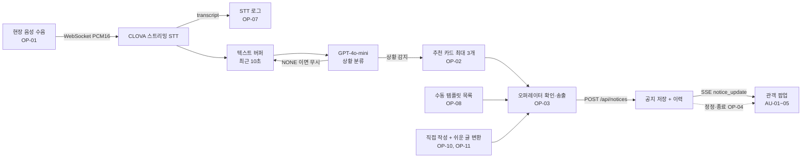
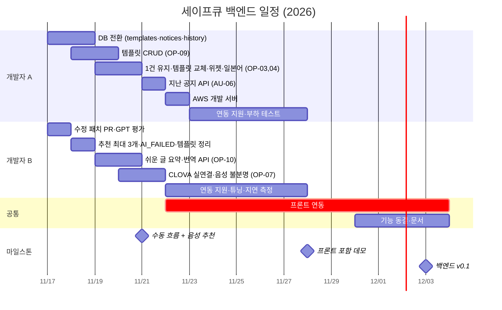

# 세이프큐(SafeQ) Backend

공연장 실시간 다국어 비상안내 시스템 · 팀 오롯이닿다
개발자 A: 정하민 (Core / 송출) · 개발자 B: 박은진 (AI 파이프라인)

현장 음성에서 상황을 감지해 오퍼레이터에게 **추천**하고, 오퍼레이터가 **승인한 공지만** 관객 기기로 송출합니다.

| 일정 | 내용 |
|---|---|
| 11/21 | 수동 흐름(템플릿 → 송출 → 정정 → 종료) + 음성 → 추천 동작 |
| 11/22 | 프론트 연동 시작 |
| 11/28 | 프론트 포함 처음부터 끝까지 데모 |
| 12/3 | 백엔드 v0.1 완료 |

> 표기: ✅ 구현됨 · 🛠 작업 예정 · ❓ 팀 확인 필요

---

## 목차

1. [실행](#1-실행)
2. [설계 원칙](#2-설계-원칙)
3. [전체 흐름](#3-전체-흐름)
4. [기능명세서 ↔ 백엔드 대응표](#4-기능명세서--백엔드-대응표)
5. [상황 분류(intent)와 템플릿](#5-상황-분류intent와-템플릿)
6. [API](#6-api)
7. [DB 스키마](#7-db-스키마)
8. [역할 분담](#8-역할-분담)
9. [타임라인](#9-타임라인)
10. [결정 사항 · 팀 확인 필요](#10-결정-사항--팀-확인-필요)
11. [협업 규칙](#11-협업-규칙)

---

## 1. 실행

```bash
pip install -r requirements.txt
cp .env.example .env               # Windows: copy .env.example .env
pytest -q
uvicorn app.main:app --reload --port 8000
```

- API 문서: `http://localhost:8000/docs`
- 오퍼레이터 마이크 테스트 (개발용): `http://localhost:8000/static/mic_test.html`
- **인증 없음** (11/10 회의: 로그인 제외)

### 모드 전환 (`.env`)

키 없이도 개발할 수 있게 mock 모드가 기본값입니다. **자동 전환은 없습니다.**
(키가 없다고 몰래 mock 으로 바뀌면 공연 중에 가짜 자막·추천이 뜰 수 있어서)

| 설정 | 값 | 필요한 키 |
|---|---|---|
| `STT_PROVIDER` | `mock` (기본, 샘플 문장) / `clova` | `CLOVA_SECRET_KEY` |
| `LLM_PROVIDER` | `mock` (기본, 키워드 규칙) / `openai` | `OPENAI_API_KEY` |

실제 모드인데 키가 비어 있으면 연결은 유지하고 해당 기능만 끈 뒤 `error` 를 한 번 보냅니다.
지금 어떤 모드인지는 오퍼레이터 WebSocket 의 `connected` 메시지(`stt_provider`, `llm_provider`)로 알 수 있습니다.

---

## 2. 설계 원칙

| 항목 | 결정 |
|---|---|
| AI 역할 | **추천만 합니다.** 오퍼레이터 화면에만 템플릿을 띄우고, 오퍼레이터가 [송출]을 눌러야 관객에게 나갑니다 (OP-02, OP-03) |
| 오경보 방지 | LLM 은 확실하지 않으면 `NONE`. 오류·타임아웃도 `NONE` 처리. 신뢰도(confidence) 판단은 쓰지 않음 |
| AI 문구 생성 | 쉬운 글 요약·번역도 **오퍼레이터가 확인하고 고친 뒤** 송출 (OP-09, OP-10) |
| 공지 개수 | **한 번에 1건만 유지**. 새 공지를 보내면 기존 공지는 종료 (OP-03) |
| 다국어 | 한국어 쉬운 글(기본) + 영어·중국어·**일본어**. 번역은 LLM 자동 생성 후 오퍼레이터 확인 |
| 진동·점멸 | **화재(비상)만** (`trigger_haptic=true`). 정정 때 1초 진동 여부는 프론트가 `action` 으로 판단 (AU-01, AU-07) |
| 통신 | 관객: **SSE** · 오퍼레이터: **WebSocket**(음성·자막·추천) + **REST**(송출·정정·종료·템플릿) |
| 재연결 | SSE `Last-Event-ID` 재전송 + 탭 복귀·네트워크 복구 시 `GET /api/notices/active` (AU-07) |
| 이력 | 생성·정정·종료마다 `notice_history` 에 정정 전후 내용 기록 (OP-04) |
| 음성 | 현장 음성 수음 → **CLOVA Speech 실시간 스트리밍** (15초 단위 과금이라 연결 하나로 계속 전송) → 최근 10초 텍스트 → **GPT-4o-mini** |
| 녹음 금지 | 오디오는 저장하지 않음. 메모리에서 CLOVA 로 넘기고 버림 (인식을 위해 네이버 클라우드로는 전송됨) |
| 인증 | 없음 (11/10 회의) |
| 서버 | AWS |

---

## 3. 전체 흐름



- 음성 → 추천 카드, 쉬운 글 요약·번역: **개발자 B**
- 템플릿 관리, 송출·정정·종료, 관객 SSE, 지난 공지: **개발자 A**

---

## 4. 기능명세서 ↔ 백엔드 대응표

### 오퍼레이터 화면

| ID | 기능 | 순위 | 백엔드 | 담당 | 상태 |
|---|---|---|---|---|---|
| OP-01 | 현장 마이크 수음 및 전송 | 1 | `WS /api/ws/operator` 에 16kHz PCM16 바이너리. 수음 OFF 는 프론트가 전송만 멈추면 됨 (30초 오디오 없으면 서버가 CLOVA 연결 정리) | B | ✅ |
| OP-02 | AI 상황 인지 및 템플릿 추천 | 1 | 6개 상황 분류(일반 안내 제외, 해당 없으면 추천 없음) → `suggestion`(유형, 근거 문장, 시각, 템플릿 **최대 3개**), AI 실패 시 `error: AI_FAILED` | B | ✅ / 🛠 최대 3개·AI_FAILED |
| OP-03 | 알림 최종 송출 | 1 | `POST /api/notices`. **1건 유지 규칙**(기존 공지 종료 후 송출), 인터미션 시간 입력 | A | ✅ / 🛠 1건 규칙 |
| OP-04 | 송출 공지 정정 및 종료 | 1 | `PATCH /api/notices/{id}`(문구·**템플릿 교체**·남은 시간), `POST .../end`, 이력 기록. 문구 수정 시 번역 재생성은 `POST /api/ai/translate` | A (+B 번역) | ✅ / 🛠 템플릿 교체 |
| OP-05 | 현재 송출 상태 모니터링 | 2 | `GET /api/notices/active`, 수신 기기 수는 `GET /api/health` 의 `audience_connected` | A | ✅ |
| OP-06 | 마이크·서버 연결 상태 | 2 | WebSocket `connected` / `ping`·`pong`, 끊기면 프론트가 재연결 | B | ✅ |
| OP-07 | 실시간 STT 로그 | 2 | `transcript`(`text`, `is_final`, `ts`), 근거 문장 = `suggestion.stt_text`, 인식 불가 구간 `[음성 불분명]` 표시용 `unclear` | B | ✅ / 🛠 unclear |
| OP-08 | 수동 템플릿 목록 조회 | 1 | `GET /api/templates` (`templates`, `by_intent`). 카테고리·검색은 프론트 필터 | A | ✅ |
| OP-09 | 템플릿 추가 및 수정 | 1 | `POST/PATCH/DELETE /api/templates` (DB). 저장 즉시 추천 후보에도 반영. 기본 비상 템플릿 삭제 불가 | A | 🛠 |
| OP-10 | 한국어 쉬운 자막 및 다국어 | 1 | `POST /api/ai/easy-text`(긴 문장 → 쉬운 글 한 문장 + 번역), `POST /api/ai/translate`(번역만) | B | 🛠 |
| OP-11 | 공지 수동 작성 | 3 | `POST /api/notices` + `POST /api/ai/easy-text` (새 API 없음) | A·B | ✅ (API 재사용) |

### 관객 화면

| ID | 기능 | 순위 | 백엔드 | 담당 | 상태 |
|---|---|---|---|---|---|
| AU-01 | 시각·촉각 강제 오버레이 | 1 | SSE `notice_update`, `trigger_haptic` (화재만 true) | A | ✅ |
| AU-02 | 표준 픽토그램 | 1 | `pictogram_code` (디자인팀 SVG 파일명과 동일, ❓ 확정 대기) | A·B | ✅ / ❓ 키 |
| AU-03 | 행동 유도형 위젯 | 1 | `widget`: `timer`(인터미션, `expires_at`) / `map`(대피로 약도 이미지) / `none` | A | ✅ timer / 🛠 map |
| AU-04 | 공지 자막 언어 선택 | 2 | 공지 한 건에 `text_ko`, `text_en`, `text_zh`, `text_ja` 함께 전송 | A | ✅ / 🛠 `text_ja` |
| AU-05 | 쉬운 글 자막 | 1 | `text_ko` = 템플릿의 쉬운 글 요약 문구 (모든 공지 공통) | A·B | ✅ |
| AU-06 | 지난 공지 목록 | 3 | `GET /api/notices/past` (종료된 공지 최신순, 정정 여부) | A | 🛠 |
| AU-07 | 공지 정정·종료 반영 | 1 | SSE `action: CORRECTED / ENDED`, `revision`, 재연결 시 `Last-Event-ID` + `/active` | A | ✅ |

### 상황별 관객 화면 기능 (기능명세서 표)

| 상황 | intent | 관객 화면 기능 | 비고 |
|---|---|---|---|
| 화재 (자연재해·비상 포함) | `FIRE` | 01, 02, 05 | 진동·점멸 + 대피로 약도 위젯(AU-03) |
| 정전 | `POWER_OUT` | 02, 05 | |
| 일시 중단 | `PAUSE` | 02, 05 | |
| 공연 지연 | `DELAY` | 02, 05 | |
| 인터미션 | `INTERMISSION` | 02, 05 | 카운트다운 타이머 위젯(AU-03) |
| 관람 예절 | `ETIQUETTE` | 02, 05 | 취식·촬영·휴대폰 금지 |
| 일반 안내 | `INFO` | (02), 05 | AI 추천 없음. 오퍼레이터가 직접 작성 |

01 = 진동·점멸 오버레이(AU-01) · 02 = 픽토그램(AU-02) · 05 = 쉬운 글 자막(AU-05, 모든 상황). 위젯(AU-03)은 화재·인터미션만.

---

## 5. 상황 분류(intent)와 템플릿

| intent | 의미 | LLM 분류 | 템플릿 | 우선순위 |
|---|---|:---:|:---:|:---:|
| `FIRE` | 화재, 지진 등 대피가 필요한 비상 상황 | O | O | 1 |
| `POWER_OUT` | 정전, 설비 이상 | O | O | 2 |
| `PAUSE` | 공연 중 일시 중단 | O | O | 3 |
| `DELAY` | 공연 시작 전 지연 | O | O | 4 |
| `INTERMISSION` | 인터미션 | O | O | 5 |
| `ETIQUETTE` | 촬영·취식·휴대폰 금지 등 | O | O | 6 |
| `INFO` | 기타 일반 안내 | **X** | O | - |
| `NONE` | 해당 없음 (공연 대사, 노래, 잡담, 불확실) | O | X | - |

**AI 는 6개 상황만 판단합니다.** 어디에도 맞지 않으면 `NONE` → 추천을 띄우지 않고,
그런 공지는 오퍼레이터가 **일반 안내(`INFO`)로 직접 작성**합니다 (OP-11 기본 유형).
맞지 않는 발화마다 일반 안내 카드를 띄우면 공연 대사·잡담에도 계속 추천이 떠서, OP-02 의 "공지 불필요 상황은 추천 미노출"과 어긋나기 때문입니다.
(기능명세서 OP-02 에 "일반 안내"가 적힌 것은 전체 카테고리를 나열한 것)

**분류 규칙 (프롬프트)**
1. 확실하지 않으면 `NONE`
2. 공연 대사·노래 가사·관객 대화는 `NONE` (예: 배우의 "불이야! 도망쳐!")
3. 여러 상황에 걸치면 우선순위가 높은 쪽 (예: "정전으로 공연을 잠시 중단합니다" → `POWER_OUT`)

**템플릿**
- intent 하나에 템플릿 여러 개 (예: `ETIQUETTE` → 촬영 금지, 취식 금지, 휴대폰 금지)
- 코드: `LLM_INTENTS`(6개 + `NONE`) / `TEMPLATE_INTENTS`(6개 + `INFO`) → 추천 대상은 겹치는 6개
- AI 가 intent 를 감지하면 해당 intent 템플릿을 `sort_order` 순으로 **최대 3개** 추천
- 오퍼레이터가 추가·수정한 템플릿(OP-09)은 저장 즉시 추천 후보에도 들어감
- 초기 데이터: `data/templates.json` (개발자 B 관리) → DB 로 넣음 (개발자 A)
- B 코드는 템플릿을 `store.templates_for_intent(intent)` 로만 읽음 (동기 함수, dict 목록)

---

## 6. API

### 6-1. 오퍼레이터 REST

| Method | Endpoint | 역할 | ID | 담당 | 상태 |
|---|---|---|---|---|---|
| GET | `/api/templates` | 템플릿 목록 (`templates`, `by_intent`) | OP-08 | A | ✅ |
| POST | `/api/templates` | 템플릿 추가 | OP-09 | A | 🛠 |
| PATCH | `/api/templates/{template_code}` | 템플릿 수정 | OP-09 | A | 🛠 |
| DELETE | `/api/templates/{template_code}` | 템플릿 삭제 (기본 비상 템플릿 불가) | OP-09 | A | 🛠 |
| POST | `/api/notices` | 공지 송출 | OP-03, 11 | A | ✅ |
| PATCH | `/api/notices/{id}` | 공지 정정 (문구, 템플릿 교체, 남은 시간) | OP-04 | A | ✅ / 🛠 템플릿 교체 |
| POST | `/api/notices/{id}/end` | 상황 종료 | OP-04 | A | ✅ |
| POST | `/api/ai/easy-text` | 긴 문장 → 쉬운 글 한 문장 + 번역 | OP-10, 11 | B | 🛠 |
| POST | `/api/ai/translate` | 한국어 → 영어·중국어·일본어 번역 | OP-04, 09 | B | 🛠 |

**공지 송출 예시**
```bash
# 인터미션 15분
curl -X POST localhost:8000/api/notices -H 'Content-Type: application/json' \
  -d '{"intent_type":"INTERMISSION","template_code":"INTERMISSION","duration_min":15}'

# 직접 작성 (일반 안내)
curl -X POST localhost:8000/api/notices -H 'Content-Type: application/json' \
  -d '{"intent_type":"INFO","pictogram_code":"info","text_ko":"좌석 안내","text_en":"Seat guide","text_zh":"座位指引","text_ja":"座席のご案内"}'
```

**1건 유지 규칙 (🛠 OP-03, 제안)**
- 송출 중인 공지가 있으면 `409 active_exists` → 프론트가 "현재 공지를 종료하고 새 공지를 송출할까요?" 팝업
- 확인하면 `replace_active: true` 로 다시 요청 → 서버가 기존 공지 `ENDED` 후 새 공지 `CREATED`
- 화재(비상)는 확인 없이 바로 대체 (❓ 협의)

**AI 문구 API (🛠 OP-10, 제안)**
```http
POST /api/ai/easy-text
{"text": "관객 여러분, 현재 무대 장치 이상으로 인해 잠시 10분간 쉬어가겠습니다."}
→ 200 {"text_ko": "10분 대기 (무대 점검)", "text_en": "...", "text_zh": "...", "text_ja": "..."}

POST /api/ai/translate
{"text_ko": "10분 대기 (무대 점검)"}
→ 200 {"text_en": "...", "text_zh": "...", "text_ja": "..."}

AI 실패 시 → 503 {"detail": "ai_unavailable"}  (프론트는 직접 입력 칸을 그대로 둠)
```
결과는 입력 칸을 채우는 용도이고, 오퍼레이터가 확인·수정한 뒤 송출합니다.

### 6-2. 관객 (인증 없음)

| Method | Endpoint | 역할 | ID | 상태 |
|---|---|---|---|---|
| GET | `/api/stream/notices` | SSE 구독 (`notice_update`, `heartbeat`) | AU-01, 07 | ✅ |
| GET | `/api/notices/active` | 현재 공지 (재연결·탭 복귀 시 동기화) | AU-07 | ✅ |
| GET | `/api/notices/past` | 지난 공지 목록 (최신순) | AU-06 | 🛠 |

```js
const es = new EventSource('/api/stream/notices');
es.addEventListener('notice_update', (e) => {
  const d = JSON.parse(e.data);
  // d.action          CREATED | CORRECTED | ENDED
  // d.intent_type     FIRE | POWER_OUT | PAUSE | DELAY | INTERMISSION | ETIQUETTE | INFO
  // d.pictogram_code  → SVG 파일
  // d.text_ko / text_en / text_zh / text_ja
  // d.trigger_haptic  화재만 true (CREATED 일 때 진동·점멸)
  // d.expires_at      인터미션 타이머 (ISO 시각)
  // d.revision        0보다 크면 "정정된 공지"
});
```
끊김 복구: 브라우저가 `Last-Event-ID` 를 자동으로 보내고 서버가 놓친 이벤트를 다시 보냅니다. 탭이 다시 활성화되거나 네트워크가 복구되면 `GET /api/notices/active` 를 한 번 더 호출하세요.

### 6-3. 오퍼레이터 WebSocket (개발자 B)

`ws://localhost:8000/api/ws/operator` (배포: `wss://…`) · 인증 없음 · 상세: [docs/WS_OPERATOR.md](docs/WS_OPERATOR.md)

| 방향 | type | 내용 | ID |
|---|---|---|---|
| 클라 → 서버 | (binary) | 16kHz · mono · PCM16, 100ms(3,200바이트) 단위. `static/pcm-worklet.js` 사용 | OP-01 |
| 클라 → 서버 | `ping` | 연결 유지 | OP-06 |
| 서버 → 클라 | `connected` | `session_id`, `stt_provider`, `llm_provider`, `audio` | OP-06 |
| 서버 → 클라 | `transcript` | `text`, `is_final`, `ts` (+ `unclear` 🛠) | OP-07 |
| 서버 → 클라 | `suggestion` | `intent_type`, `stt_text`(근거 문장), `templates[]`(최대 3개 🛠), `ts` | OP-02 |
| 서버 → 클라 | `error` | `code`, `message` (`STT_UNAVAILABLE`, `LLM_UNAVAILABLE`, `STT_ERROR`, `AI_FAILED` 🛠 …) | OP-02 |
| 서버 → 클라 | `pong` | ping 응답 | OP-06 |

- 같은 상황 추천은 30초 안에 반복하지 않음
- 추천 카드 5분 자동 소멸, 비상 빨간 테두리·알림음은 프론트 처리

### 6-4. 공통

| Method | Endpoint | 역할 |
|---|---|---|
| GET | `/api/health` | 서버 상태, 관객·오퍼레이터 접속 수 (OP-05) |
| GET | `/api/intents` | intent 목록·우선순위 |

---

## 7. DB 스키마 (🛠 개발자 A, SQLAlchemy)

**templates** (OP-08, OP-09)

| 컬럼 | 설명 |
|---|---|
| `template_code` | PK. 예: `ETIQUETTE_PHOTO` |
| `intent_type` | `FIRE` … `INFO` |
| `pictogram_code` | 디자인팀 SVG 파일명 (❓ 확정 대기) |
| `widget` | `none` / `timer` / `map` (AU-03) |
| `default_minutes` | 타이머 기본값 (인터미션 15) |
| `text_ko` | 한국어 쉬운 글 요약 문구 (예: "10분 대기 (무대 점검)") |
| `text_en`, `text_zh`, `text_ja` | 번역 |
| `is_default` | 기본 비상 템플릿 = 삭제 불가 |
| `sort_order` | 추천·목록 순서 |
| `created_at`, `updated_at` | |

**notices** (OP-03, OP-04, AU-06)

| 컬럼 | 설명 |
|---|---|
| `notice_id` | PK |
| `status` | `ACTIVE` / `ENDED` |
| `intent_type`, `template_code`, `pictogram_code`, `widget` | |
| `text_ko`, `text_en`, `text_zh`, `text_ja` | |
| `expires_at` | 타이머 종료 시각 |
| `trigger_haptic` | 화재만 true |
| `revision` | 정정 횟수 |
| `created_at`, `updated_at`, `ended_at` | |

**notice_history** (OP-04 이력, SSE 재전송 기준)

| 컬럼 | 설명 |
|---|---|
| `event_id` | PK, SSE `id` |
| `notice_id` | FK |
| `action` | `CREATED` / `CORRECTED` / `ENDED` |
| `before`, `after` | 정정 전후 공지 전체 (JSON, 모든 언어) |
| `created_at` | |

---

## 8. 역할 분담

| 구분 | 개발자 A: Core / 송출 | 개발자 B: AI 파이프라인 |
|---|---|---|
| 핵심 | 템플릿·공지·이력, 관객 송출, 서버 운영 | 음성 → 자막 → 추천, AI 문구 생성 |
| 템플릿 | DB 테이블, CRUD API (OP-09), 초기 데이터 넣기 | `templates.json` 내용 (쉬운 글 문구, 픽토그램 키, 위젯) |
| 공지 | 송출·정정·종료, 1건 유지 규칙, 템플릿 교체, 이력 (OP-03, 04) | - |
| 관객 | SSE, `/active`, 지난 공지 (AU-01~07) | - |
| 오퍼레이터 실시간 | - | WebSocket: 수음, 자막, 추천 (OP-01, 02, 06, 07) |
| AI | - | CLOVA 스트리밍, GPT-4o-mini 분류, **쉬운 글 요약·번역 API** (OP-10) |
| 품질 | SSE 부하 테스트, 송출 흐름 테스트 | 분류 혼동행렬·오경보, 번역 품질, 지연 시간 측정 |
| 운영 | AWS 개발 서버 (HTTPS/wss, CORS) | API 키, CLOVA·OpenAI 사용량 |

**맞물리는 지점**

| 연결 | 만드는 사람 | 쓰는 사람 |
|---|---|---|
| `store.templates_for_intent(intent)` (동기, dict 목록) | A | B (추천) |
| `data/templates.json` | B (내용) | A (DB 초기 데이터) |
| `app/ai/text.py` 의 `easy_text()`, `translate()` | B | A·프론트 (`/api/ai/*` 로 노출, B 가 라우터까지) |
| `POST /api/notices` | A | 오퍼레이터가 추천·목록·직접 작성에서 송출 |

---

## 9. 타임라인



| 기간 | 개발자 A | 개발자 B | 끝낼 기준 |
|---|---|---|---|
| ~11/16 (완료) | 더미 서버, 로그인 제거 | 오퍼레이터 WS, CLOVA 클라이언트, GPT 분류, 추천 (PR #2) | ✅ |
| 11/17~11/21 | DB 전환, 템플릿 CRUD, 1건 유지·템플릿 교체·위젯·`text_ja`, 지난 공지 | 수정 패치, GPT 평가, 추천 보완, 쉬운 글·번역 API, CLOVA 실연결 | **11/21** 수동 흐름(DB) + 음성 → 추천 + 쉬운 글·번역 API |
| 11/22 | AWS 개발 서버 | 연동 문서 정리 | **프론트 연동 시작** |
| 11/23~11/29 | 관객 화면·송출 연동, SSE 부하 테스트 | 오퍼레이터 화면 연동, 소음 테스트·프롬프트 튜닝, 지연 측정, 번역 검수 | **11/28** 프론트 포함 데모 |
| 11/30~12/3 | 버그 수정, 문서 | 버그 수정, 문서 | **12/3** v0.1 |

일정이 밀리면 3순위(OP-11 수동 작성 화면, AU-06 지난 공지)부터 뒤로 미룹니다.

---

## 10. 결정 사항 · 팀 확인 필요

### 결정됨
| 항목 | 결정 | 날짜 |
|---|---|---|
| 인증 | 없음 | 11/10 |
| 진동·점멸 | 화재만 | 11/10 |
| 일본어 | **포함.** 공지·템플릿·SSE·번역 API 모두 `text_ja` (없으면 `null`) | 11/17 |
| 일반 안내 | **AI 가 분류하지 않음.** 6개 상황에 안 맞으면 추천 없음 → 오퍼레이터가 일반 안내로 직접 작성 | 11/17 |
| 상황별 표 05 | 모든 상황에 쉬운 글 자막(AU-05). 위젯(AU-03)은 화재·인터미션만 | 11/17 |

### 확인 필요
| # | 항목 | 기능명세서 | 현재 서버 | 제안 |
|---|---|---|---|---|
| 1 | 화재 방향 | AU-03 은 **대피로 약도 이미지** | 화재 송출 시 `direction`(LEFT/RIGHT…) 필수 | `widget=map` 으로 바꾸고 `direction` 필수 해제 |
| 2 | 지연·중단 타이머 | 타이머는 인터미션만 (OP-03, AU-03) | `SHOW_PAUSE`, `SHOW_DELAY` 도 시간 입력 필수 | 인터미션만 `timer`, 나머지 `none` |
| 3 | 비상 공지 대체 | OP-03 "비상이면 확인 없이 대체 (협의)" | - | 화재는 확인 없이 대체 |
| 4 | 픽토그램 키 | AU-02 매핑 | 디자인팀 확정 대기 | 확정되면 `templates.json` 만 수정 |
| 5 | 무음 30초 안내 | OP-01 (협의) | - | 프론트가 입력 음량으로 판단 (서버는 30초 무음 시 CLOVA 연결만 정리) |
| 6 | 중국어·일본어 검수 | - | `templates.json` 번역은 초안 | 검수 담당 정하기 |
| 7 | 기능명세서 OP-02 문구 | 분류 목록에 "일반 안내" 포함 | AI 분류 대상 아님 | "6개 상황 분류, 해당 없으면 추천 없음"으로 수정 |

---

## 11. 협업 규칙

### 폴더 구조
```
app/
├── main.py               FastAPI 앱, CORS, health, intents
├── store.py              저장소 (→ DB 로 교체 예정, 개발자 A)
├── hub.py                SSE 구독자·오퍼레이터 연결 관리
├── routers/
│   ├── notices.py        템플릿·공지 (A)
│   ├── stream.py         관객 SSE (A)
│   └── operator.py       오퍼레이터 WebSocket (B)
└── ai/                   AI 파이프라인 (B) → docs/AI_PIPELINE.md
data/templates.json       템플릿 초기 데이터 (B)
static/                   마이크 테스트 페이지, PCM 변환 worklet (B)
docs/                     WS 명세, AI 파이프라인 문서
```

### 브랜치
- `main`: 배포용, 직접 push 금지
- `feature/mock-server`: 현재 통합 브랜치 (추후 `develop`)
- `feature/<기능>`, `fix/<내용>`: 개인 작업 → 통합 브랜치로 PR, 상대방 Approve 후 머지

### 커밋 메시지
```
feat: 템플릿 CRUD API 추가 (#12)
fix: 키 없을 때 오퍼레이터 연결 끊김 수정 (#15)
docs: README 최종 기능명세서 반영 (#18)
```
