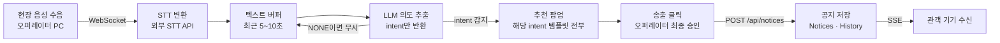
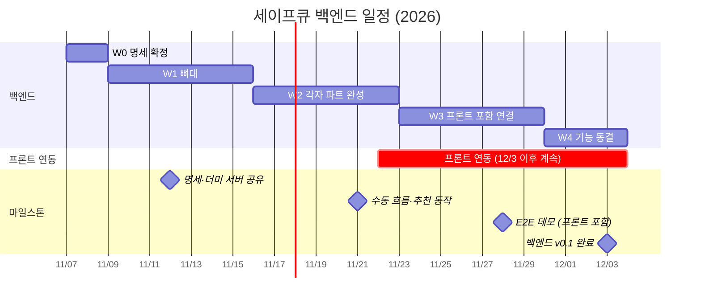

# 세이프큐(SafeQ) Backend

공연장 실시간 다국어 비상안내 시스템 **세이프큐**의 백엔드 저장소입니다. (팀 오롯이닿다)

현장 음성에서 비상 상황을 감지해 오퍼레이터에게 **추천**하고, 오퍼레이터가 **승인한 공지만** 관객 기기로 송출합니다.

- 기술 스택: Python FastAPI, SQLAlchemy, JWT, SSE(`sse-starlette`), WebSocket, 외부 STT·LLM API
- 일정: 11/22 프론트 연동 시작 · 11/28 프론트 포함 데모 · 12/3 백엔드 v0.1

---

## 목차

1. [설계 원칙](#1-설계-원칙)
2. [전체 흐름](#2-전체-흐름)
3. [Intent와 템플릿](#3-intent와-템플릿)
4. [DB 스키마](#4-db-스키마)
5. [API 명세](#5-api-명세)
6. [역할 분담](#6-역할-분담)
7. [타임라인](#7-타임라인)
8. [협업 규칙](#8-협업-규칙)

---

## 1. 설계 원칙

| 항목 | 결정 | 이유 |
| --- | --- | --- |
| AI 역할 | LLM이 상황을 감지하면 **오퍼레이터 대시보드에만** 해당 intent의 템플릿을 팝업으로 추천. 오퍼레이터가 [송출]을 눌러야 관객에게 발송 | 사람 검수 없이 전체 관객 기기를 통제하는 것은 재난안전 시스템에서 금기 |
| confidence | 파이프라인에서 삭제. `intent` 문자열만 받아 템플릿 매칭에 사용 | LLM이 내는 수치는 실제 확률이 아니라 생성된 텍스트 |
| 오경보 방지 | "확실하지 않으면 `NONE`"을 프롬프트에 규칙으로 명시 | `NONE`을 목록에 넣는 것만으로는 LLM이 무엇이든 고르려 함 |
| 다국어 | 중국어(zh-CN) 최우선, 한국어·영어 함께 지원, 일본어는 필요 시 추가 | 주 타깃 관객 기준 |
| 인증 | 오퍼레이터 API는 JWT 필수. 관객 API는 읽기 전용이라 공연 회차 정도만 확인 | API가 열려 있으면 허위 대피 명령으로 압사 사고 위험 |
| 통신 | 관객은 SSE(`EventSource` + `sse-starlette`), 오퍼레이터는 WebSocket(오디오) + REST. Socket.IO 미사용 | 관객은 받기만 하므로 SSE가 가볍고 HTTP 표준. Socket.IO는 FastAPI WebSocket과 호환되지 않음 |
| 재연결 | SSE 자동 재연결 + `Last-Event-ID`. 탭 재활성화(Visibility API)·네트워크 재연결(online 이벤트) 시 `GET /api/notices/active`로 동기화 | 모바일은 끊김이 반드시 생기고, 대피 공지를 놓치면 치명적 |
| 이력 | `Notice_History`에 생성·정정·종료마다 시각과 오퍼레이터 ID를 Append-only로 기록 | 덮어쓰기만 하면 변경 이력 추적 불가 |
| 입력 | 마이크 라인이 아닌 **현장 음성 수음**. STT 결과는 최근 5~10초 텍스트 버퍼에 쌓아 LLM에 전달 | 한 문장이 여러 조각으로 나뉘어 들어오기 때문 |

---

## 2. 전체 흐름



- 음성 수음 ~ 추천 팝업: **개발자 B**
- [송출] 클릭 이후: **개발자 A**

---

## 3. Intent와 템플릿

LLM은 7개 값 중 하나를 고르고, 확실하지 않으면 `NONE`을 반환합니다. 템플릿은 intent 하나에 여러 개일 수 있고, AI가 intent를 감지하면 그 intent의 템플릿을 전부 띄워 오퍼레이터가 고릅니다.

| intent | 의미 | LLM 분류 | 템플릿 | 우선순위 |
| --- | --- | :---: | :---: | :---: |
| `FIRE` | 화재, 대피 | O | O | 1 |
| `POWER_OUT` | 정전, 설비 이상 | O | O | 2 |
| `PAUSE` | 공연 중 일시 중단 | O | O | 3 |
| `DELAY` | 공연 시작 전 지연 | O | O | 4 |
| `INTERMISSION` | 인터미션 | O | O | 5 |
| `ETIQUETTE` | 촬영·취식·휴대폰 금지 등 관람 예절 | O | O | 6 |
| `INFO` | 기타 일반 안내 | X | O | - |
| `NONE` | 해당 없음 (공연 대사, 노래, 잡담) | O | X | - |

### 분류 규칙 (프롬프트에 그대로 넣음)

1. **확실하지 않으면 `NONE`.** 목록에 `NONE`이 있는 것만으로는 LLM이 무엇이든 고르려 하므로 규칙으로 명시합니다. 오경보를 막는 마지막 장치입니다.
2. **한 발화가 여러 상황에 걸치면 우선순위가 높은 쪽.** `FIRE > POWER_OUT > PAUSE > DELAY > INTERMISSION > ETIQUETTE`
   - 예: "정전으로 공연을 잠시 중단합니다" → `POWER_OUT`

### 코드에서 목록 분리

```python
LLM_INTENTS = ["FIRE", "POWER_OUT", "PAUSE", "DELAY", "INTERMISSION", "ETIQUETTE", "NONE"]
TEMPLATE_INTENTS = ["FIRE", "POWER_OUT", "PAUSE", "DELAY", "INTERMISSION", "ETIQUETTE", "INFO"]
```

- 겹치는 6개만 AI 추천으로 이어집니다. `NONE`은 템플릿이 없고, `INFO`는 LLM이 반환하지 않습니다.
- DB `intent_type`에는 `TEMPLATE_INTENTS`만 저장합니다.

### 템플릿은 intent와 1:N

- intent 하나에 템플릿이 여러 개일 수 있습니다. 예: `ETIQUETTE` → 촬영 금지(`ETIQUETTE_PHOTO`), 취식 금지(`ETIQUETTE_FOOD`)
- AI가 intent를 반환하면 해당 intent의 템플릿을 **전부** 오퍼레이터 화면에 띄우고, 오퍼레이터가 하나를 골라 송출합니다.
- `FIRE`, `POWER_OUT`처럼 템플릿이 하나뿐인 비상 상황은 그 하나가 바로 뜹니다.
- 템플릿은 `template_code`로 구분하고 픽토그램 키와 zh/ko/en 문구를 가집니다. 목록은 개발자 B가 백엔드 설정 파일로 관리하고 `GET /api/templates`로 제공합니다.

---

## 4. DB 스키마

### Users (오퍼레이터 인증용)

| 컬럼 | 설명 |
| --- | --- |
| `id` | PK |
| `username` | 로그인 ID |
| `password_hash` | 비밀번호 해시 |

### Notices (현재 공지 상태)

| 컬럼 | 설명 |
| --- | --- |
| `id` | PK |
| `status` | `ACTIVE` \| `ENDED` |
| `intent_type` | `TEMPLATE_INTENTS` 중 하나: `FIRE`, `POWER_OUT`, `PAUSE`, `DELAY`, `INTERMISSION`, `ETIQUETTE`, `INFO` |
| `template_code` | 송출에 쓴 템플릿 코드 (예: `ETIQUETTE_PHOTO`) |
| `pictogram_code` | 클라이언트와 미리 정해둔 키값 |
| `text_ko` | 한국어 자막 |
| `text_zh` | 중국어 자막 (최우선 다국어) |
| `text_en` | 영어 자막 |
| `text_jp` | 일본어 자막 (필요 시) |
| `expires_at` | 선택. 타이머 종료 시각(UTC) |
| `created_by` | FK, 작성한 오퍼레이터 ID |
| `created_at`, `updated_at` | 생성·수정 시각 |

### Notice_History (변경 이력, Append-only)

| 컬럼 | 설명 |
| --- | --- |
| `id` | PK |
| `notice_id` | FK, 어떤 공지의 변경인지 |
| `action` | `CREATED` \| `CORRECTED` \| `ENDED` |
| `operator_id` | FK, 누가 조작했는지 |
| `previous_text_ko`, `new_text_ko` | 정정 내용 추적용 |
| `created_at` | 변경 시각 |

---

## 5. API 명세

### 오퍼레이터 제어 REST (JWT 필수, `Authorization: Bearer <token>`)

| Method | Endpoint | 역할 | Request Body |
| --- | --- | --- | --- |
| POST | `/api/admin/login` | 오퍼레이터 로그인 | `{"username": "...", "password": "..."}` |
| GET | `/api/templates` | 템플릿 목록 조회 (intent별, 픽토그램·다국어 문구 포함). 오퍼레이터 버튼용 | - |
| POST | `/api/notices` | 새 공지 승인 및 송출 | `{"intent_type": "ETIQUETTE", "template_code": "ETIQUETTE_PHOTO", "text_ko": "...", "text_zh": "...", ...}` |
| PATCH | `/api/notices/{id}` | 기존 공지 내용 정정 | `{"text_ko": "수정된 내용", "text_zh": "..."}` |
| POST | `/api/notices/{id}/end` | 알림 강제 종료(`ENDED`로 변경) | - |

오퍼레이터 PC의 현장 음성은 WebSocket(브라우저 기본 WebSocket + FastAPI WebSocket)으로 업로드합니다.

### 오퍼레이터 추천 데이터 예시 (WebSocket)

AI가 intent를 감지하면 해당 intent의 템플릿을 전부 오퍼레이터에게 보냅니다.

```json
{
  "event": "suggestion",
  "data": {
    "intent_type": "ETIQUETTE",
    "templates": [
      {"template_code": "ETIQUETTE_PHOTO", "pictogram_code": "no_photo",
       "text_ko": "공연 중 촬영은 금지됩니다", "text_zh": "演出期间禁止拍照", "text_en": "No photography during the show"},
      {"template_code": "ETIQUETTE_FOOD", "pictogram_code": "no_food",
       "text_ko": "공연장 내 취식은 금지됩니다", "text_zh": "场内禁止饮食", "text_en": "No food or drinks in the hall"}
    ]
  }
}
```

### 관객 수신 API (인증 없음, 또는 회차 식별용 쿠키)

| Method | Endpoint | 방식 | 역할 |
| --- | --- | --- | --- |
| GET | `/api/notices/active` | REST | 현재 `ACTIVE`인 공지를 배열로 조회. 늦게 접속했거나 재연결됐을 때 화면 동기화용 |
| GET | `/api/stream/notices` | SSE | 단방향 이벤트 구독. 오퍼레이터가 송출·정정·종료할 때마다 JSON 푸시 |

### 관객 SSE 데이터 예시

```js
// 브라우저
const eventSource = new EventSource('/api/stream/notices');
eventSource.onmessage = (event) => { /* ... */ };
```

```
id: 105
event: notice_update
data: {
  "notice_id": 105,
  "action": "CREATED",
  "intent_type": "FIRE",
  "pictogram_code": "alert_fire",
  "text_ko": "화재 대피",
  "text_zh": "火灾疏散",
  "text_en": "Fire Evacuate",
  "trigger_haptic": true
}
```

`action`은 `CREATED` | `CORRECTED` | `ENDED` 중 하나입니다.

---

## 6. 역할 분담

B는 오퍼레이터 화면에 추천을 띄우는 데까지, A는 [송출] 클릭(`POST /api/notices`)부터 책임집니다.

| 구분 | 개발자 A: Core / 송출 | 개발자 B: AI 파이프라인 |
| --- | --- | --- |
| 핵심 | 인증, 공지, 이력, 관객 송출 | 현장 음성을 오퍼레이터 추천으로 바꾸기 |
| 세팅 | FastAPI 프로젝트, DB 모델(Users, Notices, Notice_History) | 오퍼레이터 WebSocket 오디오 수신 |
| 인증·AI | JWT 로그인, 오퍼레이터 API 인증 적용 | STT 연동 |
| 로직 | 공지 송출·정정·종료 API, Notice_History 기록 | 텍스트 버퍼(5~10초), LLM intent 추출 |
| 실시간 | 관객 SSE 전송, `GET /api/notices/active` | 오퍼레이터 대시보드에 템플릿 추천 전송 |
| 기타 | 개발 서버 배포 | intent별 템플릿 문구(zh/ko/en), 디자이너 C와 협업 |

공동: 명세 README 관리, 서로의 PR 리뷰, 통합 테스트

---

## 7. 타임라인



| 주차 | 개발자 A | 개발자 B | 끝낼 기준 |
| --- | --- | --- | --- |
| W0 (11/7~11/8) | 명세 확정, intent 목록 확정, 레포·브랜치 규칙 세팅 (공동) | (공동) | 명세 확정 |
| W1 (11/9~11/15) | FastAPI 세팅, DB 모델, 로그인·JWT, 공지 API 기본 | 오디오 수신, STT 연동 테스트, LLM 프롬프트 v1 | **11/12** 명세와 더미 응답 서버를 프론트에 공유 |
| W2 (11/16~11/22) | Notice_History 기록, 관객 SSE와 `GET /active`, 개발 서버 배포 | STT → 텍스트 버퍼 → LLM intent 동작, 오퍼레이터 추천 전송 | **11/21** 수동 흐름(로그인 → 송출 → 수신 → 정정 → 종료) 완성, 음성을 넣으면 추천이 나옴 · **11/22** 프론트 연동 시작 |
| W3 (11/23~11/29) | 관객 모바일 웹 연동 지원(SSE 수신, 팝업), 오퍼레이터 송출·정정·종료 연동 | 오퍼레이터 대시보드 연동 지원(마이크 입력, 추천 팝업) | **11/28** 프론트 포함 처음부터 끝까지 이어지는 데모 |
| W4 (11/30~12/3) | 버그 수정, README·Swagger 정리 (공동) | (공동) | **12/3** `main` 머지, `v0.1` 태그 |

12/3 이후에는 남은 프론트 연동을 마무리하고 리허설 테스트를 합니다.

---

## 8. 협업 규칙

### 디렉토리 구조

```
backend/
├── app/
│   ├── main.py                 # FastAPI 진입점 (CORS, 라우터 등록)
│   ├── api/
│   │   ├── endpoints/          # REST API 라우터 (notices.py, auth.py 등)
│   │   └── websockets/         # 오퍼레이터 오디오 수신, 추천 전송
│   ├── core/
│   │   ├── config.py           # 환경 변수 (DB URI, API Key 등)
│   │   └── security.py         # JWT 발급·검증
│   ├── models/                 # SQLAlchemy 모델 (Users, Notices, Notice_History)
│   ├── schemas/                # Pydantic 모델 (Request/Response 검증)
│   ├── services/
│   │   ├── ai_pipeline.py      # STT, 텍스트 버퍼, LLM 처리 (개발자 B)
│   │   └── notice_service.py   # 공지 CRUD, 이력, SSE 송출 (개발자 A)
│   └── utils/                  # 로깅, 에러 핸들러
├── requirements.txt
└── .env                        # 로컬 환경 변수 (커밋 금지)
```

### 브랜치 전략

- `main`: 배포용. 직접 Push 금지
- `develop`: 통합 브랜치
- `feature/#이슈번호-기능명`: 개인 작업 브랜치 (예: `feature/#12-sse-stream`)

### 작업 프로세스

1. GitHub Issues에 작업을 등록하고 이슈 번호를 발급받습니다.
2. `develop`에서 `feature` 브랜치를 만들어 작업합니다.
3. 작업이 끝나면 `develop`으로 PR을 올립니다.
4. 다른 백엔드 개발자의 Approve가 있어야 Merge할 수 있습니다(Branch Protection Rule).

### 커밋 메시지

```
feat: SSE 공지 스트림 구현 (#12)
fix: LLM JSON 파싱 에러 수정 (#15)
docs: API 명세 README 업데이트 (#18)
```
